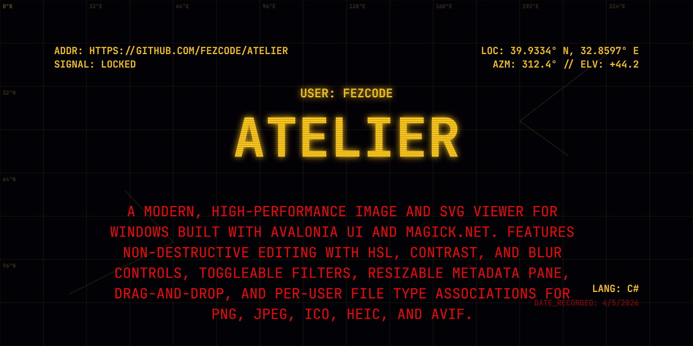
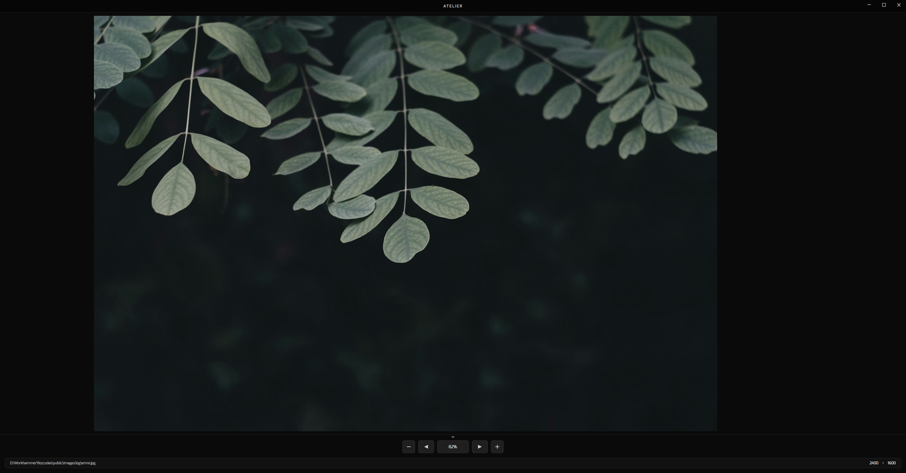

# Atelier



`Atelier` is a high-performance, modern image and SVG viewer built with **Avalonia UI** and **C#**. It provides a buttery-smooth viewing experience with native support for modern formats and advanced vector rendering.



## Features
- **Avalonia UI Core**: High-performance, cross-platform XAML-based UI.
- **Hardware Acceleration**: Uses SkiaSharp for GPU-accelerated rendering.
- **SVG Native Support**: Infinite zoom for vector graphics with high fidelity.
- **HEIC/HEIF Support**: View modern smartphone photos directly via Magick.NET.
- **Correct Orientation**: Photos that carry an EXIF orientation tag are shown the right way up, and rotating or flipping by hand picks up from there. Nothing is written until you save.
- **Animated GIF & WebP**: Plays at the frame delays the file asks for, with **Space** to pause. Very long animations fall back to a still first frame rather than filling memory.
- **Fluid Navigation**: Seamless directory browsing and centered zooming.
- **Drag & Drop**: Open any supported file or folder instantly.
- **Minimalist Design**: Clean, dark-themed interface focused on your content.
- **Paint-style editing**: **Edit → Edit Image** opens a Paint ribbon over the picture: pencil, nine brushes (calligraphy, airbrush, oil, crayon, marker, natural pencil, watercolour), fill with tolerance, text, eraser and colour replacement, colour picker, magnifier, and all of Paint's shapes with outline and fill. Rectangular and free-form selection that moves, copies, crops, deletes and pastes, plus resize and skew, canvas size, rotate, flip, invert colours and undo/redo. The brightness, saturation, hue, contrast and blur sliders and the filters are still there, applied on top until you save.
- **EXIF & Content Credentials**: the metadata pane lists EXIF by directory (camera, capture settings, GPS with coordinates) and the picture's **C2PA Content Credentials** — who signed it, when, which app or device made it, whether it came from generative AI, what was done to it and what it was made from. Read from JPEG, PNG, WebP, HEIF/AVIF and `.c2pa` sidecars; remote manifests show their URL. Signatures are shown, not verified.
- **Remove Metadata**: **File → Remove Metadata** (or the button under the pane) strips EXIF, XMP, IPTC, comments and C2PA — in place or to a clean copy. JPEG, PNG and WebP are rewritten without re-encoding, so the pixels are untouched; the colour profile and orientation are kept.
- **Save As in 30+ formats**: PNG, JPEG, WebP, AVIF, JPEG XL, TIFF, BMP, GIF, ICO, JPEG 2000, QOI, PSD, TGA, DDS, OpenEXR, Radiance HDR, PDF, EPS, the Netpbm family, PCX, SGI, Sun Raster, XPM, XBM, WBMP, FITS, Farbfeld and MIFF. Everything except PDF and EPS reopens in Atelier.
- **Hisashi menubar**: opt in under **View → Hisashi** and File / View / Edit / Help move into [Hisashi](https://github.com/fezcode/hisashi)'s macOS-style menu bar while it is running; the in-app strip hides itself. Speaks the tiny [hoswl](https://github.com/fezcode/hisashi/blob/main/docs/hoswl-protocol.md) named-pipe protocol — no dependency on Hisashi.

## Controls
- **Mouse Wheel + Ctrl**: Zoom in/out.
- **Mouse Wheel + Shift**: Pan horizontally.
- **Left/Right Arrow**: Previous/Next image in the folder.
- **`F`**: Toggle Fullscreen.
- **`R` / `Shift+R`**: Rotate right / left. **Edit → Flip Horizontal / Vertical** mirrors it.
- **`Space`**: Pause or resume an animation.
- **Ctrl+O**: Open. **Ctrl+S**: Save (enabled once a picture has been rotated). **Ctrl+Shift+S**: Save As.
- **Ctrl+C / Ctrl+V**: Copy the picture — as pixels, as the file, and as its path, so it pastes into an editor, a folder or a text box alike — and open an image from the clipboard.
- **In edit mode**: left-click paints with colour 1, right-click with colour 2. **Ctrl+Z / Ctrl+Y** undo and redo, **Ctrl+A / Ctrl+X / Ctrl+C / Ctrl+V** select, cut, copy and paste, **Del** clears the selection, arrows nudge it, **Ctrl+Shift+X** crops, **Ctrl+W** resizes and skews, **Ctrl+E** sets the canvas size, **Ctrl+Shift+I** inverts colours, **Ctrl+G** shows gridlines. Tools: **S** select, **P** pencil, **B** brush, **E** eraser, **G** fill, **I** picker, **T** text, **Z** magnifier, **L / U / O** line, rectangle, oval, **X** swaps colours, **[ / ]** change the size. Hold **Space** or the middle button to pan, and **Shift** for perfect squares, circles and 45° lines.
- **`F2`**: Rename. **`Del`**: Move to the Recycle Bin. Atelier never deletes permanently.
- **Ctrl+0 / Ctrl+1 / Ctrl+± **: Fit to window, actual size, zoom in/out.
- **Drag & Drop**: Drop any file to view.
- **File → Open File Location**: Reveal the current image in File Explorer.
- **File → Set as Wallpaper**: Fill, Fit, Stretch, Center, Tile or Span. SVG, HEIC, AVIF, WebP and ICO are converted automatically, since Windows only accepts JPG, PNG and BMP.
- **Metadata panel**: Close it with the **✕** in its header, or toggle it from **View → Image Metadata**.
- **View → Hisashi → Connect to Hisashi / Show Menus in Hisashi**: publish the menus to Hisashi's menubar (both remembered in `%APPDATA%\fezcode\Atelier\settings.json`).

## Releases
You can download the latest pre-built binaries from the [Releases](https://github.com/fezcode/Atelier/releases) page.

## Build Requirements
- **.NET 8.0 SDK**

## Building & Running
1. **Clone the repository**:
   ```bash
   git clone https://github.com/fezcode/Atelier.git
   cd Atelier
   ```

2. **Run the application**:
   ```bash
   dotnet run
   ```

3. **Run the tests** (headless Avalonia — no window is shown):
   ```bash
   dotnet test Tests/Atelier.ZoomTests
   ```

## Packaging
The Windows installer is built with [Forge](https://github.com/fezcode/Forge) from `forge.toml`:

```powershell
.\build-installer.ps1     # publish + bundle -> dist\Atelier-Setup-<version>.exe
```

The version lives in `<Version>` in `Atelier.csproj` — the About dialog reads it back off
the assembly, so keep `[app] version` in `forge.toml` in step with it.

## Application icon

The approved transparent artwork is `Assets/icon-master.png`. Run `python tools/make-icon.py` with Python and Pillow to regenerate the PNG sizes, Windows ICO and raster-backed SVG wrapper. Generated assets are committed; normal builds do not require Python.
